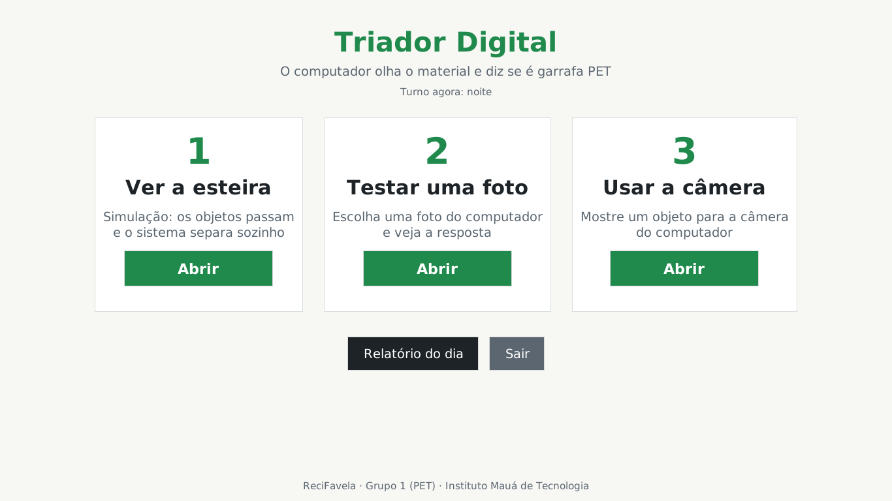
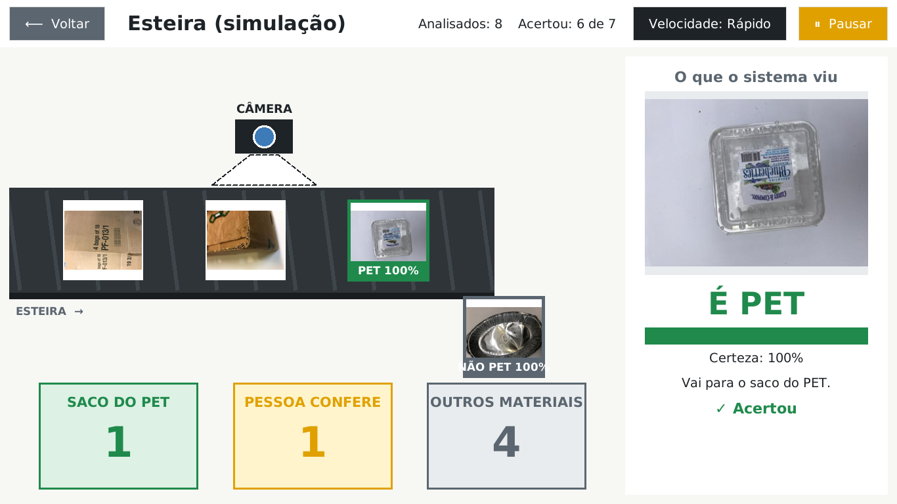
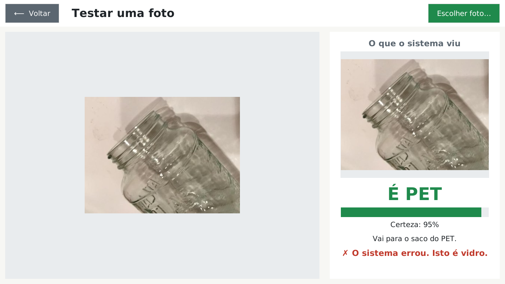
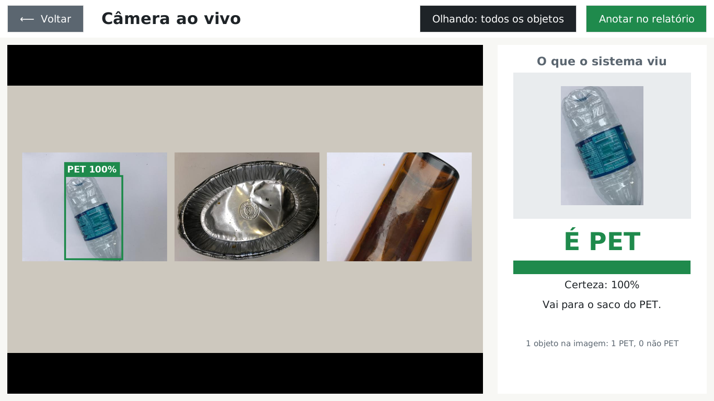
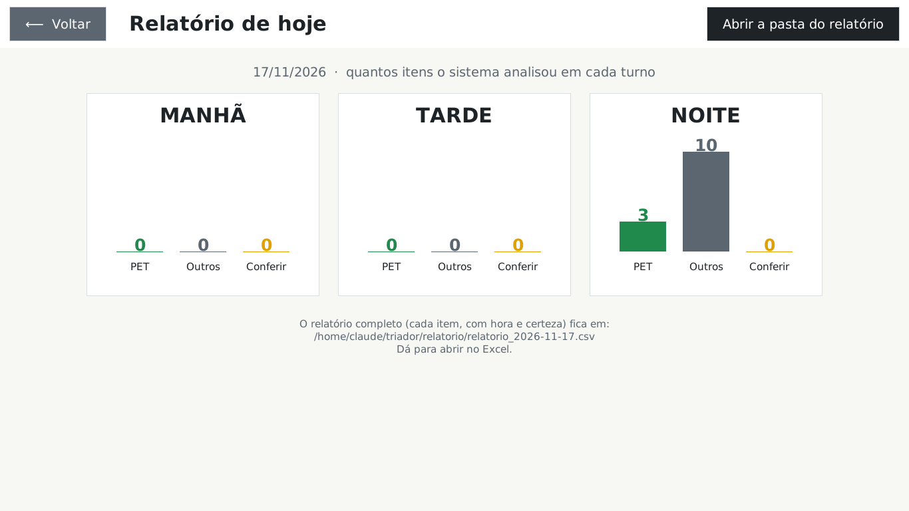
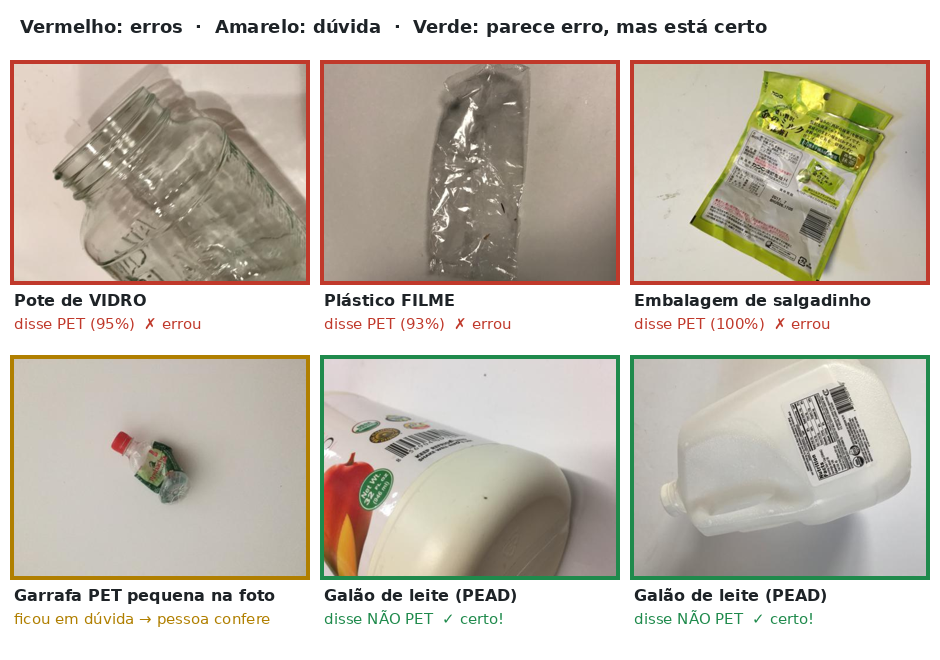
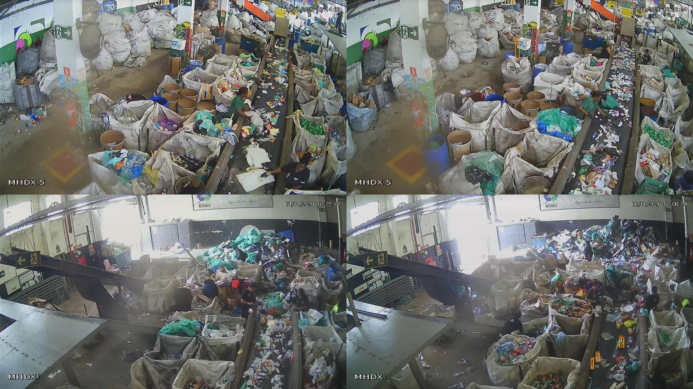

# Triador Digital – ReciFavela (Grupo 1 · PET)

**O computador olha o material e diz se é garrafa PET.**

Este programa é a parte do Grupo 1 no projeto ReciFavela. Ele usa Inteligência Artificial para reconhecer embalagens PET e contar quantas passaram em cada turno.



---

## Sumário

1. [O que o programa faz](#1-o-que-o-programa-faz)
2. [Como abrir o programa (passo a passo)](#2-como-abrir-o-programa-passo-a-passo)
3. [Como usar cada botão](#3-como-usar-cada-botão)
4. [O relatório do dia](#4-o-relatório-do-dia)
5. [Como colocar suas próprias fotos](#5-como-colocar-suas-próprias-fotos)
6. [Quanto o sistema acerta e onde ele erra](#6-quanto-o-sistema-acerta-e-onde-ele-erra)
7. [Deu problema?](#7-deu-problema)
8. [Para quem é da TI](#8-para-quem-é-da-ti)

---

## 1. O que o programa faz

Imagine uma pessoa nova na triagem. Alguém experiente mostra para ela milhares de vezes: *"isso é PET, isso não é"*. Com o tempo, ela aprende a reconhecer o PET só de olhar: é transparente, tem formato de garrafa, tem rótulo e tampa.

O sistema aprendeu do mesmo jeito: **vendo milhares de fotos com a resposta certa**. Ninguém escreveu regras.

Ele trabalha em **duas etapas**, igual ao projeto do grupo (`worker/ingestor.py`):

1. **Achar os objetos.** Um programa chamado **YOLO** olha a imagem inteira e desenha uma caixa em volta de cada objeto. Ele só diz *onde* tem algo, não o material.
2. **Dizer se é PET.** Cada caixa é recortada e vai para o "cérebro" que o grupo treinou (**ResNet18**), que responde:

| Cor | Resposta | O que fazer |
|---|---|---|
| 🟩 **Verde** | **É PET** | Vai para o saco do PET |
| ⬜ **Cinza** | **Não é PET** | Segue para a separação dos outros materiais |
| 🟨 **Amarelo** | **Conferir** | O sistema não tem certeza. **Uma pessoa precisa olhar.** |

Junto com a resposta, ele mostra a **certeza** em porcentagem. Por exemplo: *"É PET, certeza 96%"*.

> **Importante:** o programa **não separa o material sozinho**. Não tem robô nem esteira automática. Ele **reconhece e conta**. A separação continua sendo feita pelas pessoas.

---

## 2. Como abrir o programa (passo a passo)

Você vai receber um arquivo chamado **`TriadorDigital.zip`**.

1. **Clique com o botão direito** no arquivo `TriadorDigital.zip`.
2. Escolha **"Extrair tudo…"** e depois clique em **"Extrair"**.
3. Vai abrir uma pasta chamada **`TriadorDigital`**. Entre nela.
4. Dê **dois cliques** em **`TriadorDigital`** (o arquivo do tipo *Aplicativo*).
5. **Se aparecer uma tela azul** escrito *"O Windows protegeu o computador"*:
   - clique em **"Mais informações"**;
   - depois clique em **"Executar assim mesmo"**.

   Isso aparece porque o programa é novo e o Windows ainda não o conhece. Ele não faz mal ao computador.
6. Espere alguns segundos. A tela inicial abre com **três botões grandes**.

> ⚠️ **Não tire o `TriadorDigital.exe` de dentro da pasta.** Ele precisa da pasta `_internal`, que fica ao lado dele.
> Se quiser um atalho na Área de Trabalho, clique com o botão direito no `TriadorDigital.exe` → **"Enviar para"** → **"Área de trabalho (criar atalho)"**. No Windows 11, antes de "Enviar para", clique em **"Mostrar mais opções"**.

**Precisa de internet?** Não. Depois de extraído, o programa funciona sem internet.

---

## 3. Como usar cada botão

### Botão 1 – Ver a esteira (simulação)



Mostra uma esteira desenhada na tela, com fotos de materiais reais passando.

1. Clique em **"▶ Começar"** (canto de cima, à direita).
2. Cada objeto passa embaixo da **CÂMERA**. Nesse momento o sistema decide e pinta a etiqueta: **verde** (PET), **cinza** (não é PET) ou **amarela** (conferir).
3. No fim da esteira, o objeto cai no saco certo. **Os números grandes nos sacos** mostram quantos caíram em cada um.
4. Do lado direito aparece a foto que o sistema analisou, a resposta e se ele **acertou** ✓ ou **errou** ✗.
5. **"Velocidade"** troca entre devagar, normal e rápido. **"Pausar"** congela a esteira, bom para explicar com calma.

> As fotos da simulação incluem **de propósito** alguns casos em que o sistema erra (um pote de vidro, um plástico filme, uma embalagem de salgadinho), para mostrar com honestidade onde ele ainda falha.

### Botão 2 – Testar uma foto



1. Clique em **"Escolher foto…"**.
2. Escolha uma foto no computador e clique em **"Abrir"**.
3. A resposta aparece em letras grandes, do lado direito.

**Dica:** funciona melhor com **um objeto por foto**, **de perto** e com o **fundo limpo**.

### Botão 3 – Usar a câmera



1. Veja se o computador tem câmera (a maioria dos notebooks tem, em cima da tela).
2. Clique em **"Usar a câmera"**.
3. Coloque um ou mais objetos na frente da câmera. Cada objeto que o sistema encontrar ganha uma **caixa colorida** com a resposta: verde (PET), cinza (não é PET) ou amarela (conferir).
4. Do lado direito aparece o objeto principal em letras grandes e, embaixo, quantos objetos ele achou.
5. Para guardar no relatório, clique em **"Anotar no relatório"**. Anota um item para cada objeto achado.

**O botão "Olhando: …" troca o jeito de olhar:**

| Modo | Como funciona | Quando usar |
|---|---|---|
| **Olhando: todos os objetos** (padrão) | As duas etapas do projeto: o YOLO acha os objetos e a ResNet decide cada um | Para mostrar o sistema como o projeto foi feito |
| **Olhando: só o quadrado** | Aparece um quadrado no meio; a ResNet olha só ali dentro, sem o YOLO | Plano B, quando o YOLO não acha o objeto (veja a seção 6) |

> Se o YOLO não achar nenhum objeto, a ResNet olha a imagem inteira (igual ao `ingestor.py`). Ela **sempre** dá uma resposta, mesmo sem nada na frente da câmera.

#### Usar outra câmera (USB ou celular)

O programa abre a primeira câmera que encontrar. Para usar outra, clique em **"Trocar câmera"** até aparecer a imagem certa.

- **Webcam USB:** é só ligar no USB **antes** de abrir a tela da câmera. Uma webcam presa num suporte ou tripé, **olhando de cima para a mesa**, imita a câmera em cima da esteira.
- **Celular como câmera:** instale um aplicativo que transforma o celular em webcam, no celular e no computador, como o **DroidCam** ou o **Iriun Webcam** (Android e iPhone, versão gratuita). Conecte os dois (mesmo Wi-Fi ou cabo USB), abra o app no celular e depois clique em "Trocar câmera" no Triador. No Windows 11, um celular Android também pode ser usado pelo aplicativo **Link to Windows / Vincular ao Celular**.

> Se a imagem não aparecer, feche os outros programas que podem estar usando a câmera (Zoom, Teams, Meet, WhatsApp) e clique em "Trocar câmera" de novo.

---

## 4. O relatório do dia



Na tela inicial, clique em **"Relatório do dia"**. Aparecem três quadros (**manhã**, **tarde** e **noite**) com a quantidade de itens que foram PET, outros e conferir.

O turno é escolhido sozinho pelo relógio do computador:
- **manhã:** das 5h às 12h
- **tarde:** das 12h às 18h
- **noite:** das 18h às 5h

Cada item analisado também fica anotado num arquivo, na pasta **`relatorio`** (um arquivo por dia, por exemplo `relatorio_2026-11-20.csv`). **Ele abre no Excel** e tem data, hora, turno, de onde veio (esteira, foto ou câmera), resultado e certeza.

O botão **"Abrir a pasta do relatório"** abre essa pasta direto.

---

## 5. Como colocar suas próprias fotos

Dá para trocar as fotos da esteira por fotos de vocês, como fotos da linha da Recifavela.

1. Abra a pasta **`imagens_esteira`** (fica ao lado do `TriadorDigital.exe`).
2. Lá dentro tem duas pastas:
   - **`pet`**: coloque aqui as fotos de **PET**;
   - **`nao_pet`**: coloque aqui as fotos do que **não é PET**.
3. Abra o programa de novo. As fotos novas já entram na esteira.

Separando nas duas pastas, o programa sabe a resposta certa e mostra **se acertou ou errou**. Se colocar fotos soltas direto em `imagens_esteira`, elas também passam na esteira, mas sem o ✓/✗.

**Como tirar boas fotos:** um objeto por foto, de perto, com o objeto inteiro aparecendo.

---

## 6. Quanto o sistema acerta e onde ele erra

### O que medimos

| Teste | Resultado |
|---|---|
| Fotos do dataset de treino do grupo (Status Report de 18/09) | **99% de acerto** |
| **2.045 fotos reais** de vidro, metal, papel, papelão e rejeito ([TrashNet](https://github.com/garythung/trashnet)) | Errou só **5**: chamou de PET o que não era (**99,8% de acerto**) |
| **482 fotos reais de plástico** (TrashNet) | Chamou **86%** de PET. Os outros 14% foram, em grande parte, **galões de leite e de produto de limpeza (PEAD)**, que **de fato não são PET** e vão para outro processo de reciclagem. |
| **Vídeos das câmeras da linha da Recifavela** (4 vídeos, 18 momentos analisados) | **Não funcionou**: não achou as garrafas. Explicação abaixo. |

### Onde ele erra



- **Vidro transparente:** às vezes confunde com PET, porque os dois são transparentes e brilham.
- **Plástico filme e embalagens brilhantes** (saquinho, salgadinho): às vezes chama de PET.
- **Objeto muito pequeno na foto:** fica em dúvida. Nesse caso ele pede para uma pessoa conferir, que é o certo a fazer.
- **O YOLO não acha tudo.** Ele não foi treinado pelo grupo: é um modelo pronto que conhece 80 tipos de coisa do dia a dia (garrafa, copo, pessoa…). Lata amassada, bandeja de alumínio e papelão muitas vezes passam sem caixa, e então não chegam na etapa 2. Às vezes ele também dá o nome errado para o objeto (já chamou garrafa deitada de "celular"). O nome não importa, porque quem decide o material é a ResNet, mas sem caixa o objeto fica de fora. **Treinar o YOLO com fotos da linha** é um dos próximos passos.

### Por que não funcionou nos vídeos da Recifavela



O sistema aprendeu com fotos de **um objeto por vez, de perto e com fundo limpo**. As câmeras da linha ficam **no alto, longe** e mostram **tudo misturado**: cada garrafa ocupa só um pedacinho da imagem.

É como pedir para a pessoa nova da triagem reconhecer uma garrafa olhando do mezanino: de perto ela acerta, de longe não.

**O que falta para funcionar na linha:**
1. Instalar uma **câmera em cima da esteira, perto do material** (cerca de 50 cm a 1 m de altura), olhando de cima para baixo.
2. **Tirar fotos com essa câmera** na linha real e ensinar o sistema com elas: o YOLO para achar os objetos da esteira e a ResNet para reconhecer o PET sujo e amassado.
3. Ensinar **outros materiais** (alumínio, papelão, PEAD…), um de cada vez.

---

## 7. Deu problema?

| O que aconteceu | O que fazer |
|---|---|
| Tela azul *"O Windows protegeu o computador"* | Clique em **"Mais informações"** → **"Executar assim mesmo"**. |
| Dei dois cliques e nada aconteceu | Espere uns 20 segundos: a primeira vez demora. Se não abrir, veja se você **extraiu** o .zip (passo 2.2). Dentro do .zip o programa não funciona. |
| *"Não encontrei o arquivo do modelo"* | O `TriadorDigital.exe` foi tirado da pasta. Coloque-o de volta junto da pasta `_internal`. |
| *"Não encontrei nenhuma câmera"* | Veja se a webcam está ligada ou no USB. Feche Zoom, Teams, Meet e WhatsApp, que podem estar usando a câmera. |
| A esteira mostra *"Sem fotos"* | A pasta `imagens_esteira` está vazia. Coloque fotos nela (seção 5). |
| O relatório não anotou | O arquivo do relatório estava aberto no Excel. Feche o Excel e tente de novo. |
| O antivírus bloqueou | Peça para quem cuida do computador liberar a pasta `TriadorDigital`. |

---

## 8. Para quem é da TI

### O que tem nesta pasta

```
triador_digital/
├── triador.py               # o programa (Tkinter + onnxruntime), todo comentado
├── modelo/
│   ├── classificador_pet.onnx   # ResNet18 do grupo (models/best_model.pth) convertida para ONNX
│   └── detector_yolov8n.onnx    # o mesmo yolov8n.pt do worker/ingestor.py, convertido para ONNX
├── imagens_esteira/         # fotos da simulação: pet/ e nao_pet/ (TrashNet, licença MIT)
├── converter_modelo.py      # .pth (PyTorch) -> .onnx; rodar após cada novo treino
├── requirements.txt         # onnxruntime, pillow, numpy, opencv-python
├── TriadorDigital.spec      # receita do PyInstaller
├── gerar_executavel.bat     # cria o .exe e o .zip (Windows)
├── rodar_pelo_codigo.bat    # roda direto pelo Python (Windows)
├── COMO_USAR.txt            # instruções curtas que vão junto com o .exe
└── docs/                    # imagens deste README
```

### Rodar pelo código

```bash
cd triador_digital
python -m venv .venv
.venv\Scripts\activate          # Linux/Mac: source .venv/bin/activate
pip install -r requirements.txt
python triador.py               # abre a janela
python triador.py --teste       # sem janela: classifica imagens_esteira e mostra acertos
```

No Windows, dá para usar só o **`rodar_pelo_codigo.bat`**.

### Gerar o executável (Windows)

Dê dois cliques em **`gerar_executavel.bat`**. Ele:
1. cria um ambiente Python separado (`.venv_build`);
2. instala as bibliotecas e o PyInstaller;
3. roda `triador.py --teste` (se o modelo não responder, para aqui);
4. gera `dist\TriadorDigital\TriadorDigital.exe` e o `TriadorDigital.zip` para enviar.

Leva uns 5 minutos na primeira vez. O executável fica com algumas centenas de MB (não ~2 GB), porque usa o `onnxruntime` em vez do PyTorch.

### Como o programa decide

O fluxo é o mesmo da função `processar_frame` do `worker/ingestor.py`:

1. **Etapa 1, YOLOv8n:** *letterbox* para 640×640 (OpenCV, igual ao ultralytics), caixas com confiança ≥ 0,5 (`CONFIANCA_YOLO`, igual ao `CONFIANCA_MIN` do ingestor) e NMS por classe com IoU 0,7. O pós-processamento foi conferido contra o ultralytics: mesmas caixas, notas iguais até a 2ª casa.
2. **Etapa 2, ResNet18:** cada caixa é recortada, redimensionada para 224×224 e normalizada com média/desvio do ImageNet, **igual ao `src/train.py`**. Saída → *softmax* → probabilidade de `NOT_PET` e `PET`.
3. Se o YOLO não achar nada, a imagem inteira vai para a ResNet18 (igual ao ingestor).
4. **Diferença em relação ao ingestor:** se a maior probabilidade for **menor que 70%** (`LIMITE_CERTEZA`), o resultado é **CONFERIR**. O ingestor grava sempre a classe mais provável.
5. **Na esteira**, cada foto já é um objeto só, então ela vai direto para a etapa 2.
6. **No modo "só o quadrado"** da câmera, a resposta é a média das últimas 3 análises (a cada 0,4 s), para não ficar piscando.

### Atualizar o modelo depois de um novo treino

```bash
pip install torch torchvision onnx onnxruntime
python converter_modelo.py ../models/best_model.pth
python triador.py --teste
```

### Relação com o resto do repositório

- `src/train.py`, `src/evaluate.py`: treino e avaliação da ResNet18 (geram `models/best_model.pth`).
- `worker/ingestor.py` + Docker (MongoDB, InfluxDB, MinIO): pipeline de produção com YOLO, pensado para câmeras e muitos dados. O **Triador Digital** é a versão simples para uso no dia a dia e demonstração: não precisa de Docker nem de banco de dados, e o relatório fica num CSV.

### Créditos

- Modelo: Grupo 1, treinado com o [Bottle Synthetic Images Dataset](https://www.kaggle.com/datasets/vencerlanz09/bottle-synthetic-images-dataset) e o [RealWaste](https://www.kaggle.com/datasets/joebeachcapital/realwaste).
- Fotos da simulação e do teste: [TrashNet](https://github.com/garythung/trashnet) (Gary Thung e Mindy Yang, licença MIT).

**Grupo 1 – ReciFavela (Instituto Mauá de Tecnologia):** Arthur Silva Correia · Ilan Hameiry · João Victor Pessoa de Lima dos Anjos · Leonardo Souza Olivieri · Vinicius Takashi Nakatsui
